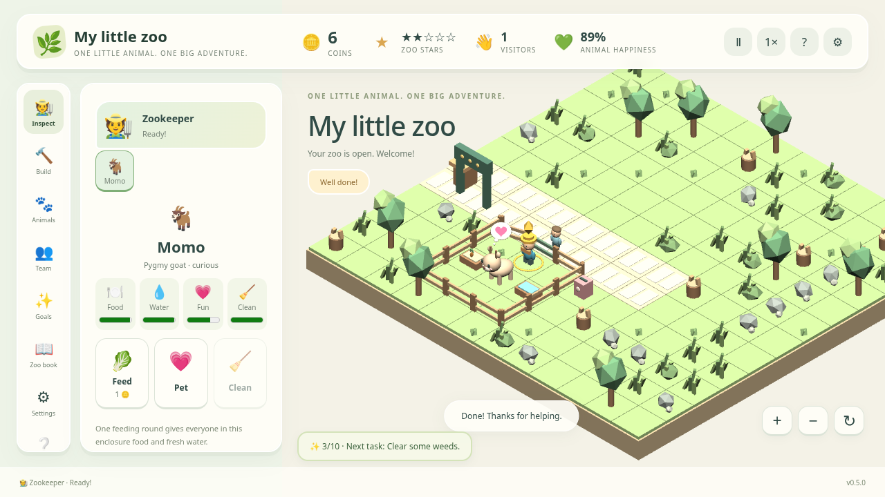

# Der coole Zoo

[](https://github.com/marcelpetrick/DerCooleZoo/actions/workflows/pipeline.yml)
[](https://marcelpetrick.github.io/DerCooleZoo/)
[](LICENSE)
[](tsconfig.json)
[](vite.config.ts)
[](https://github.com/marcelpetrick/DerCooleZoo/pkgs/container/dercoolezoo)

An isometric zoo-building browser game for children aged eight and up. Start with
one animal, an untidy plot, your own keeper, and no coins. Care for the animal,
welcome visitors, and turn their tickets and donations into a growing little zoo.

**Author:** Marcel Petrick · **License:** GPLv3 or later · **AI-assisted project**

[Play in your browser](https://marcelpetrick.github.io/DerCooleZoo/).
The game starts in German when the browser is set to German, otherwise in
English. Choose a language before starting, or switch in Settings at any time. The complete version-one requirements and verification are tracked in
[PLAN.md](PLAN.md) and [the vision audit](docs/vision-status.md).



## Play

Use a desktop browser with WebGL support. Firefox is the primary target;
Chromium is also covered by browser tests. No account or installation is needed.

1. Choose your starter animal and explore the little enclosure.
2. Click your animal (in the world or under **My animals**) and press one of three
   big buttons: **Feed**, **Pet** or **Clean**. The keeper walks over and does it
   straight away. One feeding brings food _and_ fresh water to every animal in
   that enclosure. It costs 1 coin, or nothing when you have no coins (and
   rabbit-only enclosures always eat for free).
3. The **Keeper jobs** list shows what needs doing right now (hungry animals,
   mess, weeds, the broken fence). Click a job, or click weeds and mess in the
   world, and the keeper starts at once. A new job simply replaces the old one.
4. Clear weeds and repair the enclosure, then open the zoo to visitors.
5. After eating, animals leave cartoon droppings. **Clean** tidies the whole
   enclosure in one go. Water troughs never run dry.
6. To get a new animal, open **Build → Enclosures**, pick a ready-made home
   (Meadow, Mud, Sand, Pond, Snow or Jungle; small 3 × 3 or big 4 × 4) and click
   a free spot beside a path. The fence, gate, ground, food bowl, water trough and
   shelter appear at once. Then click the animal under **Animals**: it moves into
   a fitting enclosure by itself. If no home fits, the game opens the right
   enclosure for you.
7. Build paths, benches, snack stalls, and play equipment. Happy visitors stay
   longer, buy snacks, and donate. Expand the land and adopt more animals.
8. Later, hire staff to help with care and cleaning. Their wages use coins.
   Experts can still place single fences and paint ground by hand.

New zoos start on a **12 × 12** plot with a little starter clearing and rough land
to reclaim. Existing saves keep their own layout. Clear weeds, stones, stumps and
trees, then gradually expand up to **16 × 16** tiles. Visitors arrive at a gentle
pace, and donations and goal rewards support steady growth rather than a flood of
coins. Keepers stop beside animals to care for them, and moving figures wait or
find a clear route instead of sharing a tile.

**Stop current job** frees the keeper and returns reserved planting coins. If a building or fence makes a route impossible,
the job stops safely; temporary visitor queues still wait and resume.

Select an empty tile and choose **Plant flowers · 2** to send your keeper to
plant there. Coins are refunded if that plot becomes occupied before the work
finishes. Carers skip unreachable animals and never both walk to the same one.

Use the mouse to select objects and place buildings. Camera buttons provide zoom
and rotation. Follow the short goals for the first steps. Animals never die from
management mistakes, and there are no purchases with real money or game-over debts.
Your keeper stands out in blue with a gold marker above the hat and a gold ring
underfoot. Thought clouds show food, water, rest, play, affection, and work.
Smaller, rounded people walk in passing lanes, so incoming and outgoing guests
can pass each other. Movement eases between tiles, with walking limbs and a
carried food box.

Animal thought bubbles show their actual diet; visitor hunger uses a snack icon.
Click a hungry animal to see pulsing need meters and its three care buttons.
The visible tutorial shows your next growth task. Hover over a task to read the
steps, or open Goals for the full list. UI tooltips explain actions and outcomes.

Use **? Help** for a short guide to booths, connected paths, enclosures, gates,
habitats, animal care, and saving. Expand a help topic for more detail when wanted.
Booths attract nearby guests automatically;
a vendor helps serve them.

Use the speed button to choose a relaxed **0.5×**, normal **1×**, or faster **2×**
pace, or pause whenever you like. Build tools change the pointer to a crosshair.
Sounds and five original playful tunes are generated locally and have separate
volume controls in Settings; either can be muted. **Next song** skips immediately
to another tune.

The zoo autosaves every ten seconds in this browser's local storage and restores
your progress when you reopen it. Clearing browser data removes those
saves. Export a save from Settings to keep a backup or move it to another browser;
import validates the pasted data before replacing the current zoo.

## Run locally

Requirements: Node.js 24, npm, and a desktop browser. Docker is only required for
the full production-container verification stage.

```sh
npm ci
npm run dev
```

Open the URL printed by Vite. For a production build:

```sh
npm run build
npm run preview
```

The production files are in `dist/`. Asset paths are relative, so the same build
works at the GitHub Pages repository URL and at the root of a Docker server.

## Tests and pipeline

Install the test browsers once, then run the authoritative gate:

```sh
npm ci
npx playwright install --with-deps chromium firefox
./localPipeline.sh
```

The pipeline checks formatting, ESLint, strict TypeScript, unit and integration
tests, coverage, the production build, browser end-to-end tests, and the production
Docker image. Coverage must reach **95% statements, branches, functions, and lines**
across application TypeScript. Reports are written to `coverage/`,
`playwright-report/`, and `test-results/`.

Useful commands:

| Command                     | Purpose                                         |
| --------------------------- | ----------------------------------------------- |
| `npm run dev`               | Start the Vite development server               |
| `npm run build`             | Build the static production application         |
| `npm run preview`           | Serve `dist/` on port 4173                      |
| `npm run lint`              | Check ESLint and Prettier                       |
| `npm run format`            | Apply formatting                                |
| `npm run typecheck`         | Run strict TypeScript checks                    |
| `npm test`                  | Run unit and integration tests                  |
| `npm run coverage`          | Run tests and enforce the coverage gate         |
| `npm run e2e`               | Run Playwright browser tests                    |
| `./localPipeline.sh`        | Run every release gate                          |
| `./scripts/check-docker.sh` | Build and smoke-test the container              |
| `npm run version:patch`     | Increment package and lockfile patch version    |
| `npm run version:minor`     | Increment the minor version for a major feature |

See [scripts and deployment](docs/development.md) for prerequisites, cleanup,
release behavior, and CI details.

## Docker

Build and run the game locally after verifying the local application:

```sh
docker build --tag dercoolezoo:local .
docker run --rm --publish 8080:8080 dercoolezoo:local
```

Open <http://localhost:8080>. The image serves static files using nginx as a
non-root user on port 8080 and exposes `/health`. It contains no database or user
accounts. Saves belong to the browser, so the container needs no persistent volume.

The pipeline publishes `ghcr.io/marcelpetrick/dercoolezoo:latest`, a semantic-version
tag, and an immutable `sha-<commit>` tag after verification succeeds:

```sh
docker run --rm --publish 8080:8080 ghcr.io/marcelpetrick/dercoolezoo:latest
```

See the [package page](https://github.com/marcelpetrick/DerCooleZoo/pkgs/container/dercoolezoo)
for published versions. The released image is publicly pullable without a
registry login; anonymous access was verified for version `0.3.1`.

## GitHub Pages and releases

Every push to `main` runs the same `localPipeline.sh` used locally. Only successful
verification permits the separate Pages deployment and GHCR publication jobs.
Pull requests verify the application without publishing. A manual workflow run can
repeat verification and publication for `main`.

The tested `dist/` artifact is deployed to
<https://marcelpetrick.github.io/DerCooleZoo/>. The Docker image rebuilds the same
commit with the committed dependency lockfile. Base images and GitHub Actions are
pinned by digest or commit for reproducibility.

Work happens directly on `main` in small Conventional Commits. Each commit changes
the semantic version: patches for fixes and maintenance, minor bumps for major
features. Commits and pushes must pass the available local gate first. See
[AGENTS.md](AGENTS.md) for repository rules.

## License

The source code, procedural artwork, and scripts are licensed under the
[GNU General Public License v3 or later](LICENSE). Source files carry SPDX license
and copyright notices where appropriate. The game uses original procedural models
rather than copied proprietary textures or artwork. Third-party dependencies keep
their own licenses.
